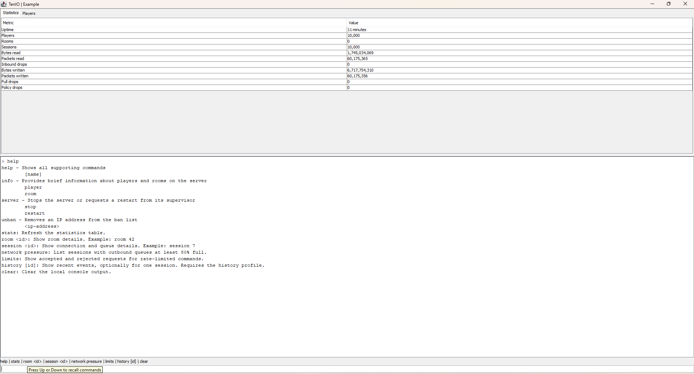
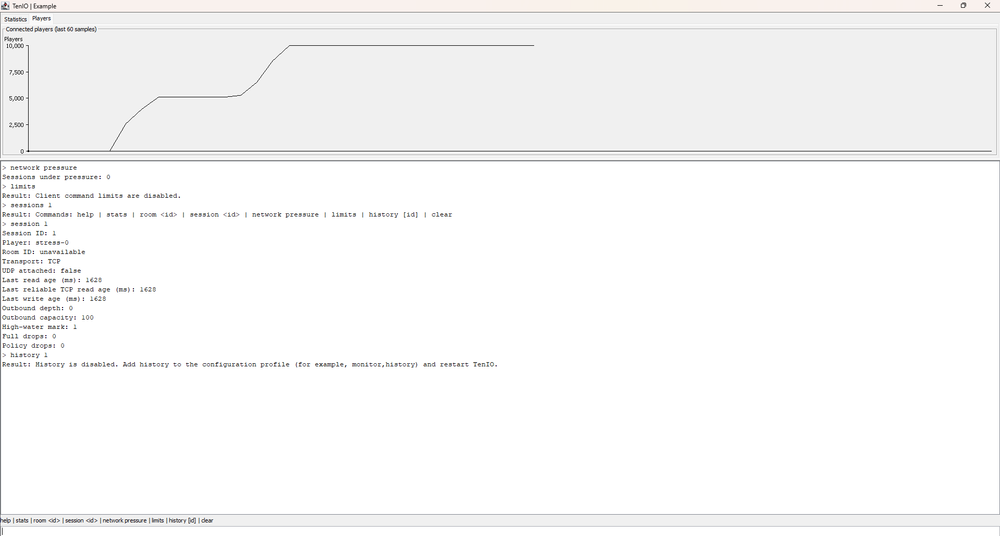
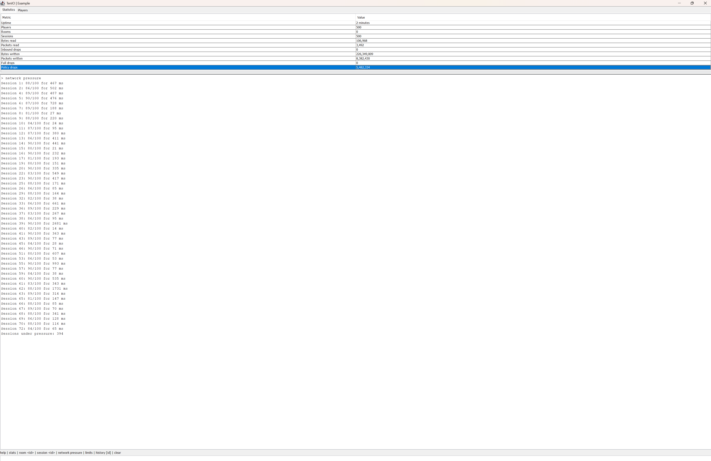

<p align="center">
  <a href="https://github.com/congcoi123/tenio">
    
  </a>
</p>

<h1 align="center">TenIO Core</h1>

<p align="center">
  Networking, sessions, rooms, and operations for multiplayer game servers.
</p>

<p align="center">
  <a href="https://github.com/congcoi123/tenio"></a>
  <a href="https://central.sonatype.com/artifact/io.github.congcoi123/tenio-core"></a>
  <a href="https://javadoc.io/doc/io.github.congcoi123/tenio-core"></a>
  <a href="LICENSE"></a>
</p>

<p align="center">
  <a href="https://github.com/congcoi123/tenio-core/actions/workflows/maven.yml"></a>
  <a href="https://coveralls.io/github/congcoi123/tenio-core?branch=master"></a>
  <a href="https://github.com/congcoi123/tenio-core/commits/master"></a>
  <a href="https://github.com/congcoi123/tenio-core/issues"></a>
  <a href="CONTRIBUTING.md"></a>
  <a href="https://discord.gg/ybkNU87Psy"></a>
</p>

<p align="center">
  <a href="#installation">Installation</a> ·
  <a href="https://github.com/congcoi123/tenio">TenIO</a> ·
  <a href="https://github.com/congcoi123/tenio-core#readme">Core guide</a> ·
  <a href="https://github.com/congcoi123/tenio-examples#readme">Examples</a> ·
  <a href="https://javadoc.io/doc/io.github.congcoi123/tenio-core">API reference</a>
</p>

[`TenIO`](https://github.com/congcoi123/tenio) is an open-source project to create multiplayer online games that includes a java NIO (Non-blocking I/O) 
based server specifically designed for multiplayer games, which supports UDP, TCP, Websocket, HTTP transports, and available simple client projects for quick development.

This module provides all the main features for the framework to operate. It contains an NIO mechanism, server configuration solution, events handling, and other necessary functions that you may find helpful.

## Framework features

| Area | Support |
| --- | --- |
| Networking | TCP, UDP, WebSocket and HTTP; sessions, connection filters and bounded queues. |
| Components and events | Profile-selected dependency injection, event handlers and annotation-driven scheduling. |
| [Client commands](#client-commands) | Automatic routing, named commands, per-player rate limits and bounded execution modes. |
| [Sessions and recovery](#sessions-and-recovery) | Token rotation, connection replacement, snapshots and bounded replay. |
| [Rooms and shared state](#rooms-and-shared-state) | Public discovery, subscriptions, typed state, visibility and revisioned deltas. |
| [Response delivery](#response-delivery) | Important, replaceable and expiring best-effort queued updates. |
| [Monitoring](#built-in-profiles) | Metrics, a local desktop console, operational history and performance archives/charts. |

## All supported events
```txt
EventAccessDatagramChannelRequestValidation
EventAccessDatagramChannelRequestValidationResult
EventBroadcastToChannel
EventChannelCreated
EventChannelWillBeRemoved
EventConnectionEstablishedResult
EventConnectionWillBeClosed
EventDisconnectPlayer
EventFetchedBandwidthInfo
EventFetchedCcuInfo
EventPlayerAfterLeftRoom
EventPlayerBeforeLeaveRoom
EventPlayerConnectionReplacing
EventPlayerJoinedRoomResult
EventPlayerLogin
EventPlayerConnectionResumed
EventPlayerConnectionRetry
EventPlayerSubscribedChannel
EventPlayerUnsubscribedChannel
EventReceivedMessageFromPlayer
EventRoomCreatedResult
EventRoomWillBeRemoved
EventSendMessageToPlayer
EventServerInitialization
EventServerTeardown
EventSocketConnectionRefused
EventSwitchParticipantToSpectatorResult
EventSwitchSpectatorToParticipantResult
EventSystemMonitoring
EventWebSocketConnectionRefused
EventWriteMessageToConnection
```

## Extension points and default rules

Register one application implementation with `@Component` (or `@Bean`) inside the bootstrap scan
path to override a server extension point. Its active profile must match. Room strategies are
selected explicitly on `InitialRoomSetting.Builder` and are created per room instead of injected.

| Interface | Built-in behavior when no override is supplied | How to change it |
| --- | --- | --- |
| `ConnectionFilter` | `DefaultConnectionFilter` rejects banned IPs and connections above `max-connections-per-ip`. The configured limit is applied at startup. | Register a filter bean implementing the complete admission/counting/ban contract. |
| `OutboundQueuePolicy` | `DefaultOutboundQueuePolicy` reads `DeliveryOptions.priority()`: reject a full queue, reject `LOW` at 75% occupancy and `NORMAL` at 90%; `HIGH` remains eligible until full. Missing options mean `NORMAL`. Priority does not reorder packets or promise delivery. | Register a policy bean using delivery settings; hard packet/byte bounds still apply. |
| `DatagramPacketPolicy` | `DefaultDatagramPacketPolicy`: `ZeroMap`/`MsgPackMap` use integer `u` (convey ID) and nested `d` (payload). `ZeroArray` takes its last integer as convey ID and removes that element from the payload. Missing/unsupported content is not routed as a player command. | Register a policy bean matching your client's UDP envelope. It does not extract application command codes. |
| `RequestPolicy` | No extra preprocessing of queued connection/UDP-access requests. This is not the gameplay command router. | Register a policy bean to preprocess those requests. |
| `BinaryPacketCompressor` | No application compressor is installed. | Register a compressor bean and implement the matching client codec. |
| `BinaryPacketEncryptor` | No application encryptor is installed. | Register an encryptor bean and implement the matching client codec. |
| `ClientCommandPolicy` | **Event mode**: decoded gameplay messages emit `RECEIVED_MESSAGE_FROM_PLAYER`. Command annotations alone do not change the wire protocol. | Register a policy bean and at least one `@ClientCommand` to select **command mode**. All gameplay messages must resolve to a registered command; there is no event fallback. |
| `RecoveryPolicy` | Recovery is disabled; no recovery registry or expiry job is created. | Register a policy bean; enroll players, privately deliver tokens and define handshake/snapshot responses. Defaults: 30-second grace, 4,096 players, 256 KiB/256 replay events per player, two-minute replay age, `SNAPSHOT` strategy. Override its default methods before startup. `recover()` captures then calls `resumed()` synchronously; override it to share your gameplay mutation lock. |
| `RoomCredentialValidatedStrategy` | `DefaultRoomCredentialValidatedStrategy` imposes no additional name/password validation. Normal room admission checks still apply. | `setRoomCredentialValidatedStrategy(MyStrategy.class)` on the room builder. |
| `RoomPlayerSlotGeneratedStrategy` | `DefaultRoomPlayerSlotGeneratedStrategy` returns slot `0`; taking/freeing slots is a no-op. It does not allocate unique participant slots. | `setRoomPlayerSlotGeneratedStrategy(MyStrategy.class)` for games requiring distinct slots. |

Startup INFO logs list the selected implementation class for each server-level extension point
under `SERVER EXTENSION POINTS`, including built-in defaults and inactive services. The log also
explains how to register a profile-matched `@Component` or `@Bean` override. Room strategies remain
per-room settings and are not selected from server extension beans.

A separate `SERVER EXTENSION POINT WARNINGS` list is logged at WARN when UDP has a configured port
but still uses `DefaultDatagramPacketPolicy`, or when client commands are registered without a
`ClientCommandPolicy`. Review the described default behavior or provide an application implementation.
No warning list is emitted when neither condition applies.

The next table describes Java interface fallback methods for custom implementations. Concrete
TenIO implementations can override them; an unavailable diagnostic is not the same as zero.

| Interface | Default methods and behavior | When an override is needed |
| --- | --- | --- |
| `ServerApi` | Short create/join/change/channel overloads delegate with no owner/password/properties, `Room.DEFAULT_SLOT`, and participant role. Delayed kick/ban, role switches, public/private messaging throw `UnsupportedOperationException` unless implemented. Recovery/discovery/replication getters return `null`; capability enable methods throw if unsupported. | A custom API must implement the operations/capabilities it exposes. `ServerApiImpl` provides the supported built-in operations; check for unavailable services before use. |
| `Server` | The source-aware `start` overload delegates to the older start signature. Filter, inspection, recovery, performance and replication getters return `null`; enabling replication throws unless supported. | A custom server must honor configuration sources and implement the services it exposes. `ServerImpl` implements the built-in services. |
| `ZeroProcessor` | `configureClientCommands` and `configureRecovery` throw `UnsupportedOperationException`. | A custom processor must implement these contracts; `ZeroProcessorImpl` supports both. |
| `RoomState` | `isIdle()` returns `false`. | Override for states that should qualify as idle. |
| `Room` | Short `addPlayer` overloads delegate without a password, with the default slot and participant role; short spectator promotion uses the default slot. `clear()` throws unless implemented. | Override only to customize those defaults; implement cleanup for a custom room. |
| `RoomManager` | Ownerless creation delegates with `null` owner. `clear()` and discovery enablement throw unless supported; `getDirectory()` returns `null`. `refreshDiscovery(room)` refreshes an existing directory, otherwise does nothing. | Custom managers must implement discovery/cleanup. Publish rooms explicitly; direct room mutations require refresh. |
| `ChannelManager` | `createChannel(id)` delegates with `null` properties. | Supply properties through the full overload. |
| `Session` | `close()` uses `EXCEPTION` for connection and player reasons. Inbound monitoring enablement is a no-op; statistics return `null`. | Use explicit close reasons; custom sessions implement diagnostics if offered. `SessionImpl` supports monitor-gated diagnostics. |
| `SessionManager` | `getOperationalHistory()` returns `null`. | Custom managers return their configured recorder; callers handle absence. |
| `Response` | Delivery options default to `null`; setting them throws unless supported. | `ResponseImpl` supports `DeliveryOptions`; custom responses must implement them to offer this feature. |
| `Packet` | Delivery options default to `null`, deadline to `0` (none); setting non-null options throws unless supported. | `PacketImpl` implements optional delivery metadata. |
| `OutboundQueue` | The short monitoring overload enables diagnostics plus optional history. `statistics()` reports current depth, `-1` for unavailable capacity/high-water/drop counters, and `0` pressure age. Delivery counters default to `-1`; configuring byte limits throws. `putWithDelivery` delegates to legacy `put` and returns `ENQUEUED`. | `OutboundQueueImpl` supplies diagnostics and delivery semantics. Custom queues must override delivery methods to provide replacement/expiry; the fallback does not provide those guarantees. |

## Client commands

### Automatic routing

Choose a message handling mode once at startup. Core caches whether commands and a policy are
present; every associated-player message pays one boolean check before the selected path.
The receive path does not rescan annotations or query the registry when command mode is disabled.
Startup INFO logs show `CLIENT MESSAGE ROUTING` as `EVENT` or `COMMAND`. Registering both kinds
of handlers produces an explicit warning that command mode takes precedence. Commands without a
policy remain in event mode and are logged as manual dispatch only. A policy without commands is
not invoked and is also reported. Restart after changing profiles, policies or registrations.

```java
@Component
public final class GameCommands implements ClientCommandPolicy {
  @Override
  public CommandRequest applyPolicy(DataCollection message) {
    if (!(message instanceof ZeroMap request) || !request.containsKey("op")) {
      return null; // Rejected in command mode, never sent to the player-message event.
    }
    return new CommandRequest(request.getShort("op"), request);
  }
}
```

Clients use the same application envelope, for example
`map.putShort("op", (short) 42).putBoolean("ready", true)`. Handshake/login messages still use
connection events. After login, TCP, UDP and WebSocket use the same command policy; UDP first
passes through `DatagramPacketPolicy`. Missing/malformed/unknown commands and full execution
mailboxes are rejected without event fallback. Valid commands use `ClientCommandManager.invoke`,
including rate limits and execution mode. Policy implementations must be thread-safe. Core
reserves neither `op` nor `42`; applications choose those values. In command mode, use an echo
command if needed, rather than also registering `EventReceivedMessageFromPlayer`.

### Execution modes

TenIO dispatches registered commands with the execution mode declared on `@ClientCommand`.
Rate limits apply before dispatch; bounded mailboxes control the number of queued/running requests.

| Execution mode | Behavior |
| --- | --- |
| `INLINE` | Default synchronous execution on the caller. |
| `SESSION` | Commands for one session share a FIFO mailbox. |
| `ROOM` | Commands for one room share a FIFO mailbox across players and handlers. |
| `CONCURRENT` | Independent virtual-thread execution within the shared admission bound. |

```java
@ClientCommand(value = 42, name = "ready", execution = ExecutionMode.ROOM,
    mailboxCapacity = 64, requestsPerSecond = 2, burst = 4)
```

Import `ExecutionMode` from `com.tenio.core.command.client`. The shared dispatcher bounds and
shutdown contract are covered in the [framework services guide](./docs/framework-services.md), section **Command execution**.

### Rate limits and command names

`requestsPerSecond` and `burst` default to zero when omitted. A zero `requestsPerSecond`
leaves a command unrestricted, even if `burst` is set. A positive rate enables limiting
per player and command. A zero `burst` uses the rate as the bucket capacity.

```java
@ClientCommand(value = 42, name = "join-room", description = "Joins a room using an invite code",
    requestsPerSecond = 2, burst = 4)
```

The optional `name` and `description` appear in the startup command list. The
`limits` view shows the code and name. Omit the name to display the handler class name.

Dispatch via `ClientCommandManager.invoke` so the limit applies before the handler executes.
A rejected invocation skips the handler. The `limits` command shows per-code counters
in the monitor window. Session inbound and outbound queue protections still apply.

For custom request routing, register a rule with `manager.getLimits().configure(code, rate, burst)`
during startup and call `allow(code, playerIdentity)` or `allowSession(code, sessionId)` before dispatch.
Register pre-login rules before the network starts so the server can release session-scoped buckets
when connections close.

## Sessions and recovery

TenIO supports token-based session recovery with authoritative snapshots, bounded event replay,
or a snapshot followed by replay. A successful recovery attaches the new TCP/WebSocket session,
rotates the token and fences the replaced connection before gameplay resumes.

Register a `RecoveryPolicy` bean to define the application's recovery handshake and snapshot.
After authenticated login, enroll the player and send the token privately over an encrypted connection:

```java
String token = api().getRecoveryManager().issue(player);
```

The policy controls grace periods and replay bounds. Capture and delivery must use the same
mutation context as gameplay. Without a registered policy, the existing login/retry flow applies.
See **Authenticated recovery** in the [framework services guide](./docs/framework-services.md) for strategies,
token lifetime, ordering and failure handling.

## Rooms and shared state

### Public room discovery

Publish bounded, searchable room summaries, query by group and public attributes, and subscribe
to directory changes. Room properties and passwords are never copied into summaries automatically.

```java
var directory = api().enableRoomDiscovery(Set.of("rank"), 10_000, 1_000);
directory.publish(room, "pong", "duel", "waiting", Map.of("rank", 3));
var page = directory.query(RoomDirectory.Query.group("pong"));
```

Create the directory during server initialization and publish the rooms intended for discovery.
Subscriptions use revisioned snapshots and deltas; a reset requires a fresh query. See
**Public room discovery** in the [framework services guide](./docs/framework-services.md) for pagination and cleanup.

### Typed replicated state

Player and room state can use schemas, visibility scopes, atomic revisions, snapshots and bounded
delta subscriptions. Define which fields are server-authoritative or owner-writable, and derive
visibility from authenticated identity and current room membership.

```java
var replication = api().enableStateReplication(10_000, 64 * 1024, 64);
var state = replication.createPlayer(player.getIdentity(), Map.of(
    "ready", new ReplicatedState.Definition(ReplicatedState.Type.BOOLEAN,
        ReplicatedState.Visibility.OWNER, true, 1)));
state.updateServer(Map.of("ready", false), -1);
```

Initialize the registry once at startup. Applications encode snapshots/deltas and send them through
their client protocol; ordinary entity property maps remain local. See
**Typed replicated state** in the [framework services guide](./docs/framework-services.md) for authorization,
revision conflicts, visibility and resynchronization.

## Response delivery

Use `Response.delivery(...)` to select how queued updates handle replacement, expiry and overflow.
Responses without delivery options retain their configured queue policy and FIFO behavior.

| Delivery mode | Behavior |
| --- | --- |
| `DeliveryOptions.important()` | `HIGH` priority; preserve queued order without expiry or replacement. Queue bounds and custom policies still apply. |
| `DeliveryOptions.replaceable(key, lifetime)` | `NORMAL` priority; replace an unclaimed queued update with the same key and transport, and expire stale updates. |
| `DeliveryOptions.bestEffort(lifetime)` | `LOW` priority; allow expiry and dropping when queue capacity admission fails. Policy rejection is recorded separately from a full queue. |

```java
response().setContent(position).setRecipientPlayer(player)
    .delivery(DeliveryOptions.replaceable("position:" + entityId, Duration.ofMillis(150)))
    .write();
```

`DeliveryOptions` is the single configuration for admission priority, replacement and lifetime.
Override a factory's priority without changing its mode, key or lifetime:

```java
var options = DeliveryOptions.replaceable("position:" + entityId, Duration.ofMillis(150))
    .withPriority(DeliveryOptions.Priority.HIGH);
response().setContent(position).setRecipientPlayer(player).delivery(options).write();
```

Priority affects congestion admission, never send order. The default policy rejects `LOW` at 75%
and `NORMAL` at 90% occupancy; `HIGH` never bypasses full queues or byte limits. Custom policies can
reject any priority. Policy rejections remain explicit even for best-effort messages; capacity
failures return a dropped admission result for best-effort. Responses without options retain
implicit `NORMAL` priority and do not allocate delivery options or enhanced queue state.

These modes govern queue admission, not end-to-end acknowledgement or durable storage. Writer-claimed
packets cannot be replaced. The current direct Netty WebSocket output bypasses these queue semantics.
See **Queued delivery** in the [framework services guide](./docs/framework-services.md) for limits and transport support.

## Built-in profiles

Set `profile` under the server's top-level `<Properties>`. Profile names are case-sensitive,
comma-separated, and selected at startup.

```xml
<Property name="profile">default,metrics,monitor,history</Property>
```

| Profile | Usage |
| --- | --- |
| `default` | Conventional baseline label used by the bundled configuration and examples. Selects application code explicitly annotated with this name. Unrestricted components and baseline server maintenance run under any profile. |
| `metrics` | Runs scheduled samples of connected players, traffic, and JVM metrics, plus a JVM deadlock scan. |
| `monitor` | Registers built-in system commands and opens the local admin window on a graphical desktop. A headless JVM skips the window. |
| `history` | Records session disconnects, reconnect outcomes, and outbound queue pressure transitions for investigation. |
| `performance` | Five-second persistent performance samples; combine with `monitor` for historical charts. See [performance history](#performance-history). |

Application-defined profiles can be combined with these names. Annotation profile lists match any
of their listed names. An empty XML profile value selects unrestricted components. The XML profile
property must be present. Restart TenIO after changing it.

### Metrics events

Built-in metrics jobs wait 60 seconds before the first run and use a 60-second interval.
Implement one or more of these interfaces from `com.tenio.core.handler.event` in an
`@EventHandler` to receive the snapshots.

| Server event | Handler interface | Data |
| --- | --- | --- |
| `FETCHED_CCU_INFO` | `EventFetchedCcuInfo` | Connected player count |
| `FETCHED_BANDWIDTH_INFO` | `EventFetchedBandwidthInfo` | Cumulative bytes, packets, and drops for reads and writes, including outbound policy and full-queue drops |
| `SYSTEM_MONITORING` | `EventSystemMonitoring` | CPU usage, memory figures, and platform thread count |

The deadlock scan reports through the server log.

```java
import com.tenio.core.bootstrap.annotation.EventHandler;
import com.tenio.core.handler.event.EventFetchedCcuInfo;

@EventHandler(profile = "metrics")
public final class PlayerCountHandler implements EventFetchedCcuInfo {
  @Override
  public void onFetchedCcuInfo(int numberPlayers) {
    System.getLogger(PlayerCountHandler.class.getName())
        .log(System.Logger.Level.INFO, "Connected players " + numberPlayers);
  }
}
```

### Performance history

The `performance` profile samples JVM health, traffic rates, player/room/session counts and command
execution into bounded rotating TSV archives under `logs/performance/`. The cadence belongs to
`PerformanceJob` and is independent of the `metrics` and `history` profiles.

Combine `performance` with `monitor` for a native Performance tab and use `performance 5` to load
the last five minutes. Archive queries run off the Swing event thread. Without `performance`,
the sampler and archive writer are not created. See
**Performance archives and native charts** in the [framework services guide](./docs/framework-services.md)
for retention, sampling fields and chart behavior.

### Monitor window and system commands

Start TenIO with `monitor` on a machine with a graphical desktop. The **Statistics** tab shows
live uptime, players, rooms, sessions, and traffic. The **Players** tab plots the last 60 samples.
Enter a command in the field at the bottom and press Enter. Up recalls older commands and Down
moves forward or restores the text you were typing. `clear` clears the output and closing the window
leaves the server running.





| Command | Usage |
| --- | --- |
| `help [all]` | Show inspection commands and preview up to 50 registered system commands. Add `all` for the full table. |
| `stats` | Refresh the Statistics tab. |
| `performance [minutes]` | Show retained performance samples. Requires `performance`; defaults to the last 60 minutes. |
| `session <id>`, `room <id> [all]` | Inspect one session or room. Session details include inbound full rejections and outbound queue drops by reason. |
| `network pressure [all]` | Show queues at least 80% full and totals for both directions. Add `all` for the full table. |
| `limits [all]` | Show accepted and rejected requests for rate-limited client commands. |
| `history [id] [all]` | Show recent operational events, optionally for a single session. Requires `history`. |
| `clear` | Clear the monitor's console output. |
| `info player [all]`, `info room [all]` | Preview ten players or rooms, or open the full table. |
| `unban <ip-address>` | Remove an address from the active connection ban list. |
| `server stop`, `server restart` | Shut down gracefully. Restart requires `-Dtenio.supervisedRestart=true` and a supervisor configured to relaunch on exit status 75. |

To add a system command, place a public handler in a scanned package. Extend
`AbstractSystemCommandHandler` and annotate it with `@SystemCommand`. The label is the first word
of the command, and the remaining words are passed to `execute`. Use `CommandUtility` to send text
back to the window. The system command manager is available in every profile. Set
`profile = CoreConstant.MONITOR_PROFILE` to create an application command only when `monitor`
is active. A command with no profile is created whenever its package is scanned.

```java
import com.tenio.core.bootstrap.annotation.SystemCommand;
import com.tenio.core.command.system.AbstractSystemCommandHandler;
import com.tenio.core.configuration.constant.CoreConstant;
import com.tenio.core.utility.CommandUtility;
import java.util.List;

@SystemCommand(label = "ping", profile = CoreConstant.MONITOR_PROFILE,
    description = "Check that the console is responding")
public final class PingCommand extends AbstractSystemCommandHandler {
  @Override
  public void execute(List<String> arguments) {
    CommandUtility.INSTANCE.showConsoleMessage("pong");
  }
}
```

Use `all` to open a scrollable snapshot for a long list. The default console output shows up
to 50 pressure rows, rate-limit counters, history events, or room members and reports when more
are available. Try `network pressure all`, `limits all`, `history 7 all`, or `room 42 all`.

### Operational history

`history` helps answer when a session closed, the recorded reason, whether a reconnect succeeded,
and when its outbound queue crossed or recovered from the 80% pressure threshold.

| Startup configuration | Storage and access |
| --- | --- |
| `monitor,history` with a graphical desktop | The newest 1,024 events are kept in memory. Enter `history` or `history 7` to preview up to 50 matching events, or add `all` for the full table, with timestamps in the window's local time zone. |
| `history` without the window | TenIO writes a new `logs/history/tenio-history-*.tsv` file each run. The file contains UTC timestamps, instance and session IDs, transport, event, and reason. It remains available after shutdown. |

File mode uses a bounded asynchronous write queue and no in-memory event archive. The server drains
pending writes during graceful shutdown and logs export failures. Keep or rotate the files according
to your deployment's retention policy.

## Guides and examples

- [Framework services guide](./docs/framework-services.md): command execution, recovery,
  response delivery, performance history, room discovery and replicated state.
- [Server initialization example](./docs/examples/ApplicationFeatures.java): room discovery and replicated state setup.
- [Room command example](./docs/examples/ReadyCommand.java): ordered room mutation and state snapshots.
- [Recovery policy example](./docs/examples/SnapshotRecovery.java): application handshake and recovery delivery.
- [Runnable server/client example](https://github.com/congcoi123/tenio-examples#example-13-framework-services):
  a TCP walkthrough of the framework services and client protocol.
- [Validation](./docs/validation.md): regression coverage, integration checks and benchmark scope.
- [Benchmark source](./src/test/java/com/tenio/core/benchmark/DisabledFeatureBenchmark.java): run
  `DisabledFeatureBenchmark.main()` in IntelliJ. The [benchmark instructions](./docs/benchmarks/disabled-results.md)
  include command-line steps for Windows, Linux and macOS.

## Requirements
Java 21+

## Dependencies
- HTTP [Jetty](https://eclipse.dev/jetty)
- Websocket [Netty](https://netty.io)

## License
The [`TenIO`](https://github.com/congcoi123/tenio) project is currently available under the [MIT](./LICENSE) License.

## Changelog
Please check out the [changelog](./CHANGELOG.md) for more details.

## Contributing
Please check out the [checklist](./CHECKLIST.md) and [contributing guideline](./CONTRIBUTING.md) for more details.

## WebSocket transport

Declare a WebSocket port and choose the bind address in XML:

```xml
<Properties>
  <Property name="server-address">127.0.0.1</Property>
</Properties>
<Network>
  <Sockets>
    <Port name="websocket" type="websocket">8033</Port>
  </Sockets>
  <Properties>
    <Property name="websocket-using-ssl">false</Property>
  </Properties>
</Network>
```

These sections belong inside the existing `Server` element. `server-address` applies to
TCP and WebSocket listeners; use `0.0.0.0` when remote clients must connect over IPv4.
Any HTTP upgrade path is accepted, so clients may use `ws://localhost:8033/websocket`.
The WebSocket listener is started only when its port is configured.

| Behavior | Default |
| --- | --- |
| Payload | One unprefixed TenIO binary packet per complete WebSocket message; ZeroMap or MessagePack according to the TenIO header. Text messages close with status 1003. |
| Fragmentation | Binary continuation frames are aggregated before decoding; each frame is limited to 64 KiB and a complete message to 1 MiB. |
| HTTP handshake | 16 KiB maximum HTTP body and a 10-second read timeout until upgrade succeeds. Invalid upgrades are rejected and closed. |
| Control frames | Ping receives a pong with the same payload; close receives a close reply. These frames do not create player sessions. |
| Extensions | WebSocket compression extensions are not negotiated. TenIO packet compression is separate and must match the application codec. |
| Application lifecycle | The first binary packet requests a connection; subsequent packets use the normal logged-in session processing. Ping frames do not replace an application heartbeat for idle-player checks. |
| Delivery options | Direct WebSocket writes do not use the TCP outbound queue's replacement, expiry or priority semantics. |

For WSS, set `websocket-using-ssl` to `true`, point `-Dkeystore.file.path` to a JKS
keystore containing the server certificate and private key, and supply its password through
`TENIO_KEYSTORE_PASSWORD` (or `-Dkeystore.file.password`). The certificate must match the
hostname used by clients and be trusted by them. Missing or invalid TLS configuration fails
startup. Do not use test keys or disable certificate verification in deployed clients.
Application login and authorization remain required; an HTTP upgrade is not a player login.

Example 7 includes a JDK WebSocket test client for login, fragmented movement, ping and close.

## Installation
Maven Central
```xml
<dependency>
    <groupId>io.github.congcoi123</groupId>
    <artifactId>tenio-core</artifactId>
    <version>1.1.0</version>
</dependency>
```
GitHub
```sh
$ git clone https://github.com/congcoi123/tenio-core.git
```

> Happy coding !
